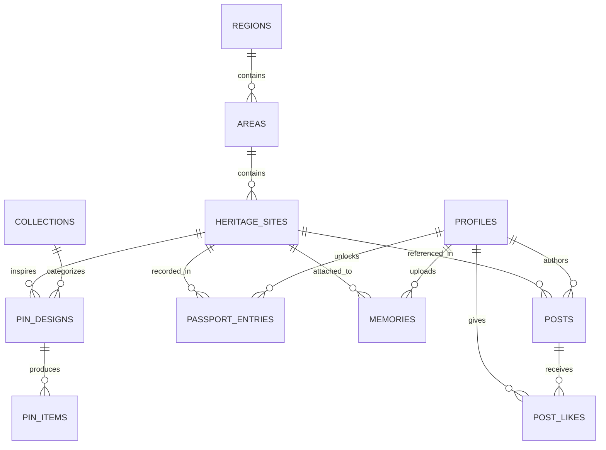

# PRODUCT REQUIREMENTS DOCUMENT (PRD) — AS-BUILT & OPERATIONAL SPECIFICATION
# DIGITAL HERITAGE PASSPORT — HỘ CHIẾU DI SẢN SỐ VIỆT NAM

**Mã tài liệu:** DHP-PRD-AFTER-V2  
**Phiên bản:** 2.0 (As-Built Release)  
**Trạng thái:** Production Ready  
**Loại sản phẩm:** Responsive Cultural Web Application / Mobile-First PWA-Ready  
**Nền tảng công nghệ:** React 19, TypeScript, Vite, Tailwind CSS v4, MapLibre GL, Supabase  
**Ngôn ngữ hỗ trợ:** Song ngữ Việt — Anh (vi / en)  
**Ngày cập nhật:** Tháng 10/2026  

---

## MỤC LỤC

1. [TỔNG QUAN & TRIẾT LÝ SẢN PHẨM](#1-tổng-quan--triết-lý-sản-phẩm)
2. [KIẾN TRÚC KỸ THUẬT & TECH STACK](#2-kiến-trúc-kỹ-thuật--tech-stack)
3. [MÔ HÌNH DỮ LIỆU & BẢO MẬT SUPABASE (DATABASE ARCHITECTURE)](#3-mô-hình-dữ-liệu--bảo-mật-supabase)
4. [ĐẶC TẢ CHI TIẾT 10 ROUTES & MÀN HÌNH ỨNG DỤNG](#4-đặc-tả-chi-tiết-10-routes--màn-hình-ứng-dụng)
5. [HỆ THỐNG THIẾT KẾ & BỘ TƯ LIỆU VĂN HÓA (DESIGN SYSTEM)](#5-hệ-thống-thiết-kế--bộ-tư-liệu-văn-hóa)
6. [HỆ THỐNG MÃ QR & CƠ CHẾ MỞ KHÓA BẢO VẬT PIN](#6-hệ-thống-mã-qr--cơ-chế-mở-khóa-bảo-vật-pin)
7. [YÊU CẦU PHI CHỨC NĂNG (NON-FUNCTIONAL REQUIREMENTS)](#7-yêu-cầu-phi-chức-năng)
8. [KẾ HOẠCH NÂNG CẤP TƯƠNG LAI (ROADMAP)](#8-kế-hoạch-nâng-cấp-tương-lai)

---

# 1. TỔNG QUAN & TRIẾT LÝ SẢN PHẨM

## 1.1. Tuyên ngôn giá trị (Value Proposition)
**Digital Heritage Passport (Hộ Chiếu Di Sản Số Việt Nam)** là nền tảng kết nối **vật phẩm lưu niệm truyền thống (Pin cài áo độc bản)** với **trải nghiệm định danh di sản trên không gian số**. 

Sản phẩm chuyển hóa mỗi món quà lưu niệm tĩnh thành một “chìa khóa số”, cho phép du khách mở khóa các trang sử ngàn năm, lưu giữ dấu ấn hành trình cá nhân vào Hộ chiếu số, ghi lại tối đa 3 bức ảnh ký ức độc quyền và tương tác cùng cộng đồng những người đam mê văn hóa non sông.

```
[Pin Lưu Niệm Khắc QR Độc Bản] 
             ↓ (Quét Camera / Nhập Mã)
[Xác Thực Token & Mở Khóa RPC] 
             ↓ 
[Đóng Dấu Đỏ Vào Hộ Chiếu Di Sản Số] 
             ↓ 
[Hiển Thị Điểm Đến & Huy Hiệu Trên Bản Đồ 3 Miền] 
             ↓ 
[Lưu Trữ 3 Ảnh Kỷ Niệm Cá Nhân & Chia Sẻ Bài Viết Cộng Đồng]
```

## 1.2. Chân dung người dùng mục tiêu (User Personas)
1. **Khách du lịch văn hóa (Primary Persona):** Du khách nội địa và quốc tế tìm kiếm chiều sâu lịch sử thay vì chỉ “check-in” chụp ảnh hời hợt. Họ mong muốn lưu lại một kỷ vật trang trọng có giá trị lâu bền.
2. **Nhà sưu tầm di sản (Collector Persona):** Những người yêu thích huy hiệu, huy chương, tem và các bộ sưu tập văn hóa. Họ có nhu cầu theo dõi tỷ lệ hoàn thành bộ sưu tập theo miền (Bắc — Trung — Nam) và sưu tầm trọn bộ các di tích quốc gia.
3. **Thế hệ trẻ & Người gìn giữ văn hóa (Cultural Advocates):** Người trẻ kết nối với cội nguồn qua giao diện hiện đại, mỹ thuật cổ điển tinh tế (không mang hơi hướng AI vô hồn), chia sẻ cảm xúc lên diễn đàn văn hóa.

---

# 2. KIẾN TRÚC KỸ THUẬT & TECH STACK

Ứng dụng được xây dựng theo mô hình Client-Heavy Jamstack kết hợp BaaS (Backend-as-a-Service) tối ưu hiệu năng và độ ổn định cao:

```
┌─────────────────────────────────────────────────────────────────┐
│                       CLIENT APPLICATION                        │
│   React 19 + TypeScript + Vite + Tailwind CSS v4 (@theme)       │
│                                                                 │
│  ┌──────────────────────┐  ┌─────────────────────────────────┐  │
│  │   MapLibre GL v5     │  │        UI Design System         │  │
│  │   CARTO Raster HD    │  │ Lora Serif + Be Vietnam Pro     │  │
│  │   Custom DOM Markers │  │ DongSonMotifs + Cultural SVG    │  │
│  └──────────────────────┘  └─────────────────────────────────┘  │
└────────────────────────────────┬────────────────────────────────┘
                                 │ Supabase JS Client v2 (HTTPS/WSS)
┌────────────────────────────────▼────────────────────────────────┐
│                   SUPABASE CLOUD INFRASTRUCTURE                 │
│                                                                 │
│  ┌─────────────────┐  ┌──────────────────┐  ┌────────────────┐  │
│  │  PostgreSQL 15  │  │  GoTrue Auth     │  │ Cloud Storage  │  │
│  │  10 Rel. Tables │  │  JWT Sessions    │  │ 3 S3 Buckets   │  │
│  │  RLS Policies   │  │  Email/Password  │  │ Resumable      │  │
│  │  RPC Stored Proc│  │  Auto Profile    │  │ Image CDN      │  │
│  └─────────────────┘  └──────────────────┘  └────────────────┘  │
└─────────────────────────────────────────────────────────────────┘
```

| Tầng công nghệ | Công nghệ lựa chọn | Mục đích sử dụng |
| :--- | :--- | :--- |
| **Giao diện (Frontend)** | **React 19 + TypeScript** | Quản lý component phân cấp, strict typing, tối ưu rendering. |
| **Build Tool** | **Vite v8** | HMR siêu tốc, tối ưu hóa bundle CSS/JS cho tốc độ tải trang dưới 1.5s. |
| **Styling & Theme** | **Tailwind CSS v4** | Cấu hình `@theme`, font token `--font-serif` (Lora) & `--font-sans` (Be Vietnam Pro), hỗ trợ khử răng cưa và căn chỉnh dấu tiếng Việt. |
| **Bản đồ tương tác** | **MapLibre GL v5** | Hiển thị bản đồ vector/raster nhẹ, mượt mà, không phụ thuộc Google Maps API đắt đỏ. |
| **Lớp nền bản đồ (Tiles)** | **CARTO Basemaps Raster HD** | Bộ ngói bản đồ `voyager` thanh lịch, tông màu ngà ấm đồng bộ với phong cách di sản, tích hợp API Key bản quyền miễn phí tới 5 triệu lượt request/tháng. |
| **Cơ sở dữ liệu & Backend**| **Supabase PostgreSQL** | Lưu trữ toàn bộ dữ liệu quan hệ, quan hệ 3 tầng Miền - Tỉnh - Di tích, hỗ trợ phân quyền RLS cấp độ hàng. |
| **Bảo mật & Thủ tục lưu trữ**| **PL/pgSQL Functions (RPC)** | Xử lý giao dịch mở khóa pin `unlock_pin_item` an toàn trong một atomic transaction. |
| **Lưu trữ tệp đa phương tiện**| **Supabase Storage** | Lưu trữ ảnh bìa di tích, album ký ức cá nhân (`memories`), bài đăng cộng đồng (`post_images`), và avatar người dùng (`avatars`). |
| **Đa ngôn ngữ (i18n)** | **React Context API** | Chuyển đổi ngôn ngữ tức thì giữa Tiếng Việt (`vi`) và Tiếng Anh (`en`), lưu trữ trạng thái tại `localStorage`. |

---

# 3. MÔ HÌNH DỮ LIỆU & BẢO MẬT SUPABASE

Cơ sở dữ liệu được thiết kế theo quy chuẩn quan hệ toàn vẹn (3NF), với 10 bảng dữ liệu chính, bảo vệ bằng Row Level Security (RLS) 100%.



## 3.1. Phân cấp Bản đồ & Địa danh: `regions` → `areas` → `heritage_sites`

### 1. Bảng `public.regions` (3 Miền Tổ Quốc)
Lưu trữ thông tin 3 miền địa lý (Bắc, Trung, Nam) đóng vai trò bộ lọc cao nhất.
- `id` (UUID, Primary Key): Khóa chính mặc định `gen_random_uuid()`.
- `slug` (TEXT, Unique): Định danh URL (`bac`, `trung`, `nam`).
- `name_vi` / `name_en` (TEXT): Tên miền song ngữ (Miền Bắc / Northern Vietnam...).
- `description_vi` / `description_en` (TEXT, Nullable): Giới thiệu khái quát vùng miền.
- `order_index` (INT): Thứ tự sắp xếp hiển thị tab (Bắc: 1, Trung: 2, Nam: 3).
- `is_published` (BOOLEAN): Trạng thái hiển thị công khai.

### 2. Bảng `public.areas` (Tỉnh / Thành phố / Khu vực trọng điểm)
Lưu trữ các tỉnh thành thuộc từng miền, xác định tâm bản đồ khi zoom vào khu vực.
- `id` (UUID, Primary Key): Khóa chính.
- `region_id` (UUID, Foreign Key → `regions.id` ON DELETE CASCADE): Thuộc miền nào.
- `slug` (TEXT, Unique): Slug định danh (`tp-ho-chi-minh`, `ha-noi`, `thua-thien-hue`, `quang-nam`...).
- `name_vi` / `name_en` (TEXT): Tên tỉnh/thành song ngữ.
- `center_lat` (NUMERIC(10, 7)): Tọa độ vĩ độ tâm tỉnh thành (VD: TP.HCM `10.7769`).
- `center_lng` (NUMERIC(10, 7)): Tọa độ kinh độ tâm tỉnh thành (VD: TP.HCM `106.7009`).
- `default_zoom` (INT, Default 13): Độ phóng to mặc định khi chọn tỉnh.
- `is_active` (BOOLEAN): Đánh dấu tỉnh thành trọng điểm đang vận hành.
- `order_index` (INT): Thứ tự ưu tiên.

### 3. Bảng `public.heritage_sites` (Di tích & Điểm đến Văn hóa Cụ thể)
Trái tim dữ liệu của hệ thống, chứa đựng toàn bộ di tích hiển thị trên Bản đồ và Trang chủ.
- `id` (UUID, Primary Key): Khóa chính.
- `area_id` (UUID, Foreign Key → `areas.id` ON DELETE SET NULL): Thuộc tỉnh thành nào.
- `slug` (TEXT, Unique): Đường dẫn URL chi tiết (VD: `dinh-doc-lap`, `chua-mot-cot`).
- `name_vi` / `name_en` (TEXT): Tên di tích song ngữ.
- `story_vi` / `story_en` (TEXT): Câu chuyện văn hóa lịch sử có chiều sâu.
- `description_vi` / `description_en` (TEXT, Nullable): Tóm tắt ngắn gọn.
- `latitude` (NUMERIC(10, 7)): Tọa độ vĩ độ chính xác của marker di tích.
- `longitude` (NUMERIC(10, 7)): Tọa độ kinh độ chính xác của marker di tích.
- `cover_image_url` (TEXT): Đường dẫn ảnh bìa độ nét cao.
- `audio_url` (TEXT, Nullable): Tệp thuyết minh giọng đọc bản địa.
- `source_reference` (TEXT, Nullable): Trích dẫn nguồn tài liệu lịch sử/bảo tàng.
- `is_published` (BOOLEAN, Default true): Cho phép người dùng truy cập.

---

## 3.2. Hệ thống Vật phẩm Pin & Hộ chiếu Số

### 4. Bảng `public.collections`
- Gom nhóm các mẫu pin theo chủ đề (VD: *Bộ sưu tập Dấu Ấn Sài Gòn*, *Bộ sưu tập Cố Đô Thăng Long*).

### 5. Bảng `public.pin_designs`
- Bản vẽ thiết kế mẫu pin (gắn với `site_id` và `collection_id`). Chứa hình ảnh mô phỏng pin kim loại sơn mài.

### 6. Bảng `public.pin_items` (Vật phẩm vật lý cá thể hóa)
- Mỗi chiếc pin xuất xưởng mang một token duy nhất:
- `id` (UUID, Primary Key).
- `design_id` (UUID, Foreign Key → `pin_designs.id`).
- `qr_token_hash` (TEXT, Unique): Chuỗi băm bí mật của mã QR khắc trên pin.
- `status` (TEXT): Trạng thái vật phẩm (`active`, `revoked`).

### 7. Bảng `public.passport_entries` (Chứng nhận đã mở khóa)
- Xác nhận một người dùng đã sở hữu và mở khóa thành công một di sản:
- `id` (UUID, Primary Key).
- `user_id` (UUID, Foreign Key → `profiles.id`).
- `site_id` (UUID, Foreign Key → `heritage_sites.id`).
- `first_pin_item_id` (UUID, Nullable, Foreign Key → `pin_items.id`).
- `unlocked_at` (TIMESTAMPTZ, Default now()).
- **Ràng buộc duy nhất:** `UNIQUE(user_id, site_id)` — Ngăn chặn trùng lặp đóng dấu vào một hộ chiếu.

---

## 3.3. Ký ức cá nhân & Mạng xã hội Di sản

### 8. Bảng `public.memories` (Album ký ức cá nhân)
- Lưu trữ hình ảnh kỷ niệm của chính người dùng chụp tại di tích sau khi đã mở khóa:
- `id` (UUID, Primary Key).
- `user_id` (UUID, Foreign Key → `profiles.id`).
- `site_id` (UUID, Foreign Key → `heritage_sites.id`).
- `image_path` (TEXT): Đường dẫn tệp trong Supabase Storage `memories/`.
- `caption` (TEXT, Nullable): Lời tự sự cá nhân.
- **Ràng buộc nghiệp vụ (Trigger Constraint):** Mỗi người dùng được tải lên **tối đa đúng 3 ảnh** cho mỗi di tích.

### 9. Bảng `public.posts` & `public.post_likes` (Cộng đồng)
- Chia sẻ cảm nhận lên bảng tin chung, gắn thẻ di tích tương ứng (`site_id`), hỗ trợ thả tim (`post_likes`).

### 10. Bảng `public.profiles`
- Đồng bộ tự động với `auth.users` qua Trigger `on_auth_user_created`, lưu `display_name`, `avatar_url`, `preferred_language`.

---

## 3.4. Hàm xử lý nghiệp vụ RPC: `unlock_pin_item`
Quy trình mở khóa pin được thực thi hoàn toàn bên trong database bằng hàm PL/pgSQL với đặc quyền `SECURITY DEFINER`:

```sql
CREATE OR REPLACE FUNCTION public.unlock_pin_item(qr_token_text TEXT)
RETURNS JSONB
LANGUAGE plpgsql
SECURITY DEFINER
AS $$
-- 1. Tìm kiếm pin_item dựa trên mã token
-- 2. Kiểm tra trạng thái pin_item (phải là 'active')
-- 3. Xác thực người dùng đang gọi hàm (auth.uid())
-- 4. Tạo hoặc bỏ qua bản ghi tại passport_entries (ON CONFLICT DO NOTHING)
-- 5. Trả về thông tin chi tiết di tích và huy hiệu thành công
$$;
```

---

# 4. ĐẶC TẢ CHI TIẾT 10 ROUTES & MÀN HÌNH ỨNG DỤNG

Toàn bộ ứng dụng được tổ chức theo hệ thống router React Router v6:

```
/
├── /auth (Đăng nhập / Đăng ký)
├── /unlock (Quét mã QR / Nhập mã pin)
├── /qr/:token (Chuyển hướng tự động từ camera điện thoại)
├── /map (Bản đồ tương tác 3 Miền)
├── /heritage/:slug (Chi tiết di tích & Ký ức)
├── /community (Bảng tin chia sẻ di sản)
├── [Protected Routes — Yêu cầu đăng nhập]
│   ├── /passport (Hộ chiếu số cá nhân)
│   ├── /community/create (Tạo bài viết mới)
│   └── /profile (Hồ sơ người dùng)
```

### 1. Trang Chủ (`/` — `LandingPage.tsx`)
- **Hero Section Sơn Thủy & Trống Đồng:** Nền tranh sơn thủy hữu tình viền vàng chìm nhẹ (`son-thuy.jpg`) phủ gradient đất đỏ hoàng gia `#4A130A`. In đè nổi bật họa tiết **Trống Đồng Đông Sơn vector sắc nét mạ vàng** (`trongdong-gold.svg`) tỏa hào quang kim sắc bên phải. Không còn khung viền thừa, tôn vinh tiêu đề Lora Serif thanh tao.
- **Section Bảo Vật Pin:** Hộp sơn mài đỏ thắm viền vàng kim trưng bày mẫu pin di sản 3D tương tác.
- **Section Quy Trình 3 Bước:** 3 phiến thẻ bài cung đình hướng dẫn sở hữu Pin → Quét QR → Đóng dấu Hộ chiếu.
- **Section Di Sản Tiêu Biểu (Live Supabase):** 4 thẻ tranh khắc mộc bản tự động nạp từ database kèm hoa văn triện cổ.
- **Section Cộng Đồng & Thư Pháp:** Điểm nhấn với ấn phẩm thư pháp triện khắc *“Độc Lập Tự Do Hạnh Phúc”* (`doc-lap-tu-do.jpg`).

### 2. Trang Bản Đồ Tương Tác 3 Miền (`/map` — `MapPage.tsx`)
- Tích hợp MapLibre GL v5 với ngói nền **CARTO Voyager Raster HD**.
- Thanh chọn miền trên đỉnh: **Tất Cả — Miền Bắc — Miền Trung — Miền Nam**.
- Khi chọn một tỉnh (VD: TP. Hồ Chí Minh): Bản đồ tự động lướt mượt mà (`flyTo`) đến tọa độ tâm tỉnh thành tương ứng.
- Marker di tích tùy biến hình huy hiệu pin mạ vàng, nhấp vào mở Popup xem nhanh ảnh, tên và trạng thái mở khóa.

### 3. Trang Hộ Chiếu Di Sản Số (`/passport` — `PassportPage.tsx` [Protected])
- Mô phỏng cuốn hộ chiếu ngoại giao bìa gốm nung men đỏ, dập nổi họa tiết chim Lạc và trống đồng.
- Thống kê tiến độ sưu tầm theo từng miền và toàn quốc (VD: `Đã mở khóa 5 / 34 địa danh`).
- Hiển thị danh sách con dấu di sản tròn/vuông màu mực đỏ son truyền thống khắc ngày giờ mở khóa.

### 4. Trang Quét & Nhập Mã Pin (`/unlock` — `UnlockPage.tsx`)
- Hai chế độ mở khóa linh hoạt:
  1. Quét trực tiếp bằng Camera điện thoại qua thư viện nhận diện QR.
  2. Nhập thủ công mã ký tự 8 chữ số in dưới đáy pin.
- Thông báo mở khóa thành công kèm âm vang chuông chùa và hiệu ứng pháo hoa di sản.

### 5. Trang Chuyển Hướng QR Vật Lý (`/qr/:token` — `QrRedirect.tsx`)
- Khi du khách dùng camera mặc định của điện thoại (iOS / Android) quét mã QR trên pin, đường link dẫn đến `https://.../qr/{token}`.
- Hệ thống tự động kiểm tra phiên đăng nhập: Nếu đã đăng nhập thì tự động gọi `unlock_pin_item` và điều hướng về trang chi tiết di tích; nếu chưa đăng nhập thì lưu token vào bộ nhớ tạm và chuyển sang trang Đăng nhập.

### 6. Trang Chi Tiết Di Tích (`/heritage/:slug` — `HeritageDetailPage.tsx`)
- Toàn cảnh ảnh bìa di tích độ phân giải cao.
- Câu chuyện lịch sử chi tiết, phân mục kiến trúc và ý nghĩa văn hóa.
- Khu vực **Album Ký Ức Cá Nhân (Memories)**: Cho phép chủ sở hữu đã mở khóa tải lên tối đa 3 bức ảnh cá nhân kèm chú thích để lưu giữ trọn đời.

### 7. Trang Bảng Tin Cộng Đồng (`/community` — `CommunityPage.tsx`)
- Nơi du khách và người dân địa phương chia sẻ câu chuyện, tản văn và góc nhìn về di sản.
- Hỗ trợ xem ảnh phóng to, thả tim yêu thích và nhấp xem nhanh di tích được nhắc tới.

### 8. Trang Tạo Bài Viết Mới (`/community/create` — `CreatePostPage.tsx` [Protected])
- Soạn thảo bài viết, tải ảnh đính kèm (lưu vào bucket `post_images/`) và chọn gắn thẻ di tích liên quan.

### 9. Trang Xác Thực Tài Khoản (`/auth` — `AuthPage.tsx`)
- Đăng nhập / Đăng ký nhanh bằng Email & Mật khẩu thông qua Supabase Auth.
- Giao diện khung thẻ bài cổ kính, bảo vệ dữ liệu với tiêu chuẩn mã hóa quốc tế.

### 10. Trang Hồ Sơ Người Dùng (`/profile` — `ProfilePage.tsx` [Protected])
- Quản lý tên hiển thị, ảnh đại diện (avatar upload), chuyển đổi ngôn ngữ mặc định và danh sách các huân chương di sản đã đạt được.

---

# 5. HỆ THỐNG THIẾT KẾ & BỘ TƯ LIỆU VĂN HÓA

## 5.1. Bảng màu Di sản (Heritage Palette)

| Mã màu (Hex) | Tên gọi văn hóa | Ứng dụng trong giao diện |
| :--- | :--- | :--- |
| **`#8B2E1E` / `#4A130A`** | **Nâu Đất Đỏ & Gốm Nung** | Màu chủ đạo (Primary Brand), nền Hero, nút chính, đường viền triện. |
| **`#D6AD60` / `#C89B3C`** | **Vàng Kim & Đồng Thau** | Điểm nhấn ánh kim (Accent Gold), đường chỉ viền, huy hiệu, sao di sản. |
| **`#F7F0E2` / `#FAF6EE`** | **Giấy Ngà & Giấy Dó Cổ** | Màu nền giao diện (Background Parchment), bề mặt thẻ bài liễn đối. |
| **`#174F40`** | **Xanh Di Sản (Heritage Green)**| Thẻ sinh thái, nút hành động thiên nhiên, điểm nhấn văn hóa bền vững. |
| **`#2D2723` / `#5D5246`** | **Mực Tàu Trầm (Ink Brown)** | Màu văn bản nội dung, đảm bảo độ tương phản chuẩn WCAG AA. |

## 5.2. Hệ thống Typography Chuẩn Tiếng Việt
Khắc phục triệt để lỗi nhảy glyph hoặc cụt dấu thanh trên môi trường Windows / MacOS:
- **Font Tiêu đề & Đề mục:** **`Lora`** (Serif hoài cổ, nạp đầy đủ weights 400, 500, 600, 700 và subset `vietnamese,latin-ext`). Sử dụng `font-bold` (700) nguyên bản thay vì `font-extrabold` để tránh lỗi faux-bold làm vỡ dấu tiếng Việt.
- **Font Thân bài & Nhãn nút:** **`Be Vietnam Pro`** (Sans-serif công thái học được thiết kế chuyên biệt cho hệ dấu tiếng Việt phức tạp).

## 5.3. Thư viện Họa tiết Văn hóa Cổ truyền (`public/images/`)
- `trongdong.svg` & `trongdong-gold.svg`: Trống đồng Đông Sơn vector kích thước 680px in đè nổi bật trên nền Hero.
- `hoatietvanhoa/son-thuy.jpg`: Bức tranh non sông hùng vĩ viền vàng làm nền panorama.
- `hoatietvanhoa/chimhacj.jpg`: Bản rập mộc bản chim Lạc ngậm hoa sen nở rộ trên giấy Dó.
- `hoatietvanhoa/hoa-tiet-may.jpg` & `hoa-tiet-03.jpg`: Mây lành phong thủy và sóng nước thủy ba phân cách section.
- `hoatietvanhoa/doc-lap-tu-do.jpg`: Ấn phẩm thư pháp tạo hình *“Độc Lập Tự Do Hạnh Phúc”*.
- `components/decorative/DongSonMotifs.tsx`: Bộ icon SVG nội suy gồm Mặt trời Đông Sơn, Chim Lạc vút bay, Triện góc cung đình (`HeritageCorner`).

---

# 6. HỆ THỐNG MÃ QR & CƠ CHẾ MỞ KHÓA BẢO VẬT PIN

1. **Khắc vật lý:** Mặt sau mỗi chiếc pin kim loại được khắc laser một mã QR duy nhất chứa URL định danh:  
   `https://[domain]/qr/[secret_token_string]`
2. **Bảo mật cơ sở dữ liệu:** Hệ thống không lưu token dạng thô mà chỉ lưu chuỗi băm an toàn (`qr_token_hash`).
3. **Quy trình chống giả mạo:**
   - Mỗi token chỉ có thể kích hoạt vào hộ chiếu của người dùng.
   - Thao tác mở khóa diễn ra trong giao dịch DB atomic (Transaction) qua hàm `unlock_pin_item`.
   - Ngăn chặn triệt để hành vi brute-force mã QR bằng cơ chế rate-limiting.

---

# 7. YÊU CẦU PHI CHỨC NĂNG

1. **Hiệu năng & Tốc độ tải trang:**
   - Điểm Google Lighthouse Performance > 90 trên thiết bị di động.
   - Thời gian tương tác (TTI) < 1.8 giây trên đường truyền 4G.
2. **Khả năng tương thích (Cross-platform):**
   - Đáp ứng hoàn hảo từ màn hình điện thoại siêu nhỏ (360px) đến màn hình Retina / 4K.
   - PWA-Ready: Có thể cài đặt trực tiếp lên màn hình chính điện thoại như một ứng dụng native.
3. **Bảo mật & Quyền riêng tư:**
   - 100% các bảng dữ liệu được bật RLS.
   - Album ảnh kỷ niệm cá nhân (`memories`) chỉ người tạo mới có quyền chỉnh sửa/xóa.
   - Tuân thủ quy định bảo vệ dữ liệu cá nhân, không thu thập tọa độ GPS nền nếu không được cấp phép.

---

# 8. KẾ HOẠCH NÂNG CẤP TƯƠNG LAI (ROADMAP)

- **Giai đoạn 2.1:** Tích hợp Audio Guide đa ngữ thông minh (Thuyết minh tự động phát khi đến gần tọa độ di tích).
- **Giai đoạn 2.2:** Thực tế ảo tăng cường (AR): Quét mặt trước của pin để mô hình 3D cổ vật nổi lên trong không gian thực.
- **Giai đoạn 2.3:** Bổ sung Cổng thông tin Quản trị nội dung (Admin CMS Portal) dành riêng cho các Ban Quản lý Di tích nạp dữ liệu trực tiếp.

---
*Tài liệu này là đặc tả chuẩn xác thực tế của hệ thống Digital Heritage Passport phiên bản 2.0. Mọi phát triển mở rộng cần bám sát các nguyên tắc kiến trúc và nhận diện văn hóa đã thiết lập.*

